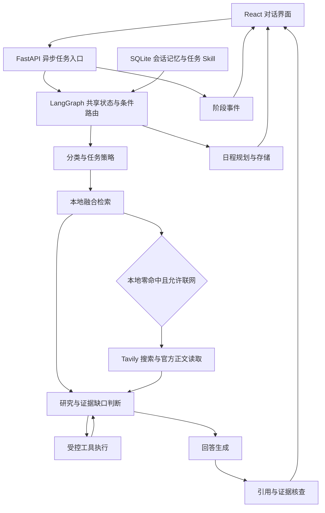

# 系统架构

`app/agent/main_agent.py` 是图编排入口，节点读取与更新共享状态。条件分支控制后续研究、工具执行和回答生成；并非每个节点都调用模型，检索与参数校验可直接执行确定性代码。

`app/api/task_service.py` 管理当前进程中的异步任务，运行记录另行持久化。持久化记录不等同于保存可恢复的协程或图检查点，服务重启不能据此承诺断点续跑。

工具注册表负责工具描述、参数与权限约束。研究阶段获取证据，生成阶段组织回答，核查阶段检查结构、引用和证据支持，工具预算与时间预算限制循环。

公开政策库位于 `data/store/`，个人会话与配置位于 `data/private/`，二者不随 Git 分发。`scripts/bootstrap_demo.py` 将官方 HTML 样例转为带来源、版本和段落定位的快照，再建立可重建的 SQLite 索引。

本地检索基于关键词、BM25 与 RRF，不是 Embedding 向量检索。当前实现不包含 Redis 工作记忆、向量情景记忆或可恢复 Checkpoint，避免将方案描述为已实现能力。
